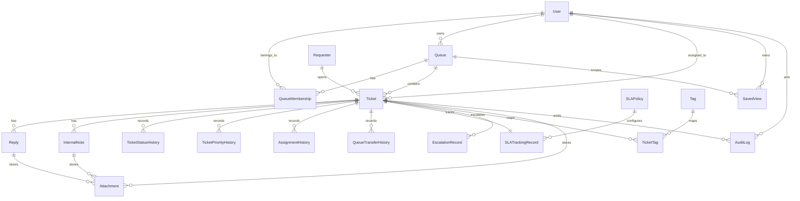

# Domain Model

## Entity ownership map

- `User`
  Schema/model file: `prisma/schema.prisma` model `User`
  Primary service file: `src/services/session-service.ts`

- `Queue`
  Schema/model file: `prisma/schema.prisma` model `Queue`
  Primary service file: `src/services/ticket-service.ts`

- `Requester`
  Schema/model file: `prisma/schema.prisma` model `Requester`
  Primary service file: `src/services/ticket-service.ts`

- `Ticket`
  Schema/model file: `prisma/schema.prisma` model `Ticket`
  Primary service file: `src/services/ticket-service.ts`

- `Reply`
  Schema/model file: `prisma/schema.prisma` model `Reply`
  Primary service file: `src/services/ticket-service.ts` function `addPublicReply()`

- `InternalNote`
  Schema/model file: `prisma/schema.prisma` model `InternalNote`
  Primary service file: `src/services/ticket-service.ts` function `addInternalNote()`

- `TicketStatusHistory`
  Schema/model file: `prisma/schema.prisma` model `TicketStatusHistory`
  Primary service file: `src/services/ticket-service.ts` function `changeTicketStatus()`

- `TicketPriorityHistory`
  Schema/model file: `prisma/schema.prisma` model `TicketPriorityHistory`
  Primary service file: `src/services/ticket-service.ts` function `updateTicketMetadata()`

- `AssignmentHistory`
  Schema/model file: `prisma/schema.prisma` model `AssignmentHistory`
  Primary service file: `src/services/ticket-service.ts` function `reassignTicket()`

- `QueueTransferHistory`
  Schema/model file: `prisma/schema.prisma` model `QueueTransferHistory`
  Primary service file: `src/services/ticket-service.ts` function `reassignTicket()`

- `SLAPolicy`
  Schema/model file: `prisma/schema.prisma` model `SLAPolicy`
  Primary service file: `src/services/sla-service.ts`

- `SLATrackingRecord`
  Schema/model file: `prisma/schema.prisma` model `SLATrackingRecord`
  Primary service file: `src/services/sla-service.ts`

- `EscalationRecord`
  Schema/model file: `prisma/schema.prisma` model `EscalationRecord`
  Primary service file: `src/services/ticket-service.ts` function `escalateTicket()`

- `Tag` and `TicketTag`
  Schema/model file: `prisma/schema.prisma` models `Tag` and `TicketTag`
  Primary service file: `src/services/ticket-service.ts` functions `createTicket()` and `updateTicketMetadata()`

- `Attachment`
  Schema/model file: `prisma/schema.prisma` model `Attachment`
  Primary service file: attachment reads are exposed through `src/services/ticket-service.ts` function `getTicketDetail()`

- `SavedView`
  Schema/model file: `prisma/schema.prisma` model `SavedView`
  Primary service file: `src/services/saved-view-service.ts`

- `AuditLog`
  Schema/model file: `prisma/schema.prisma` model `AuditLog`
  Primary service file: `src/services/ticket-service.ts`
